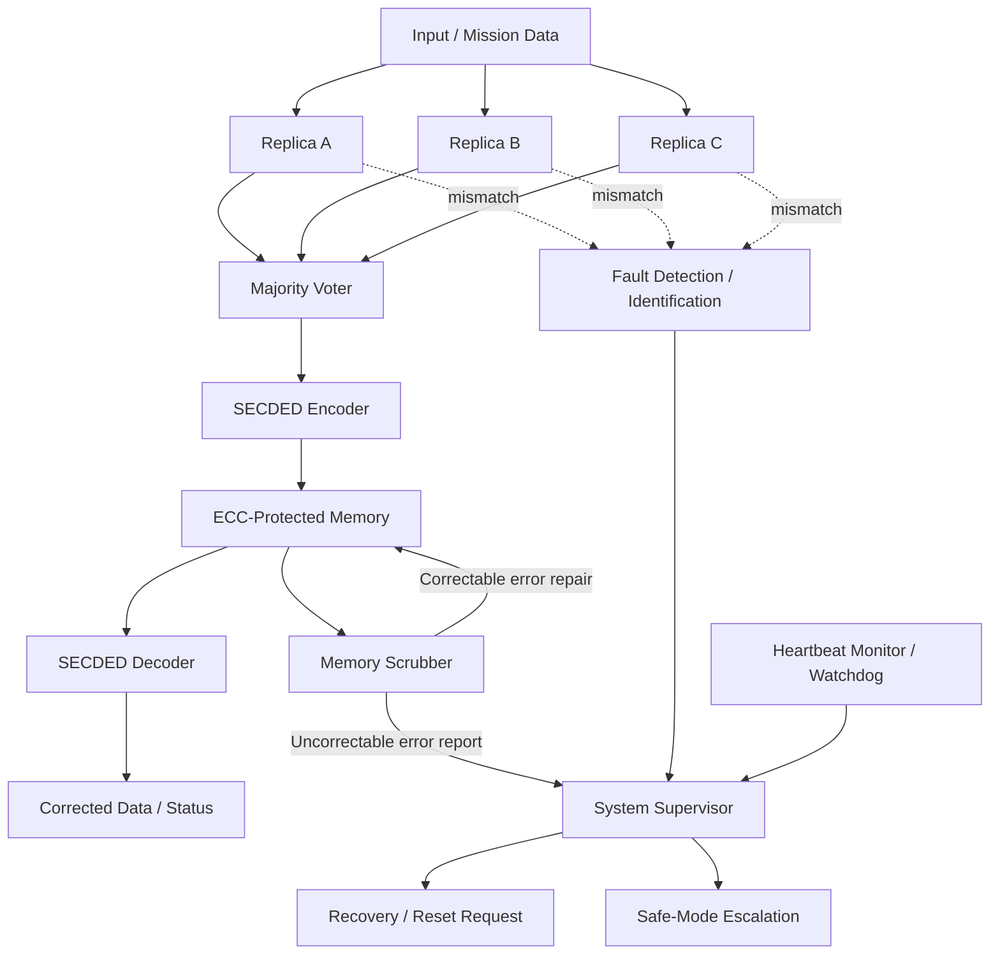
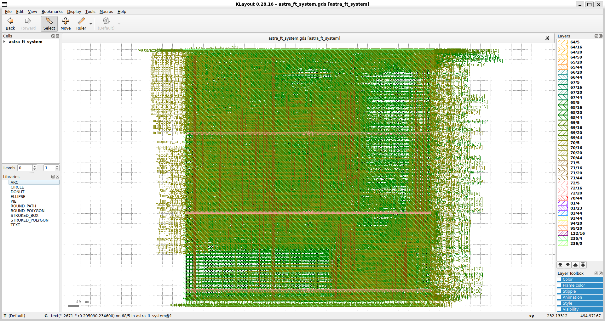
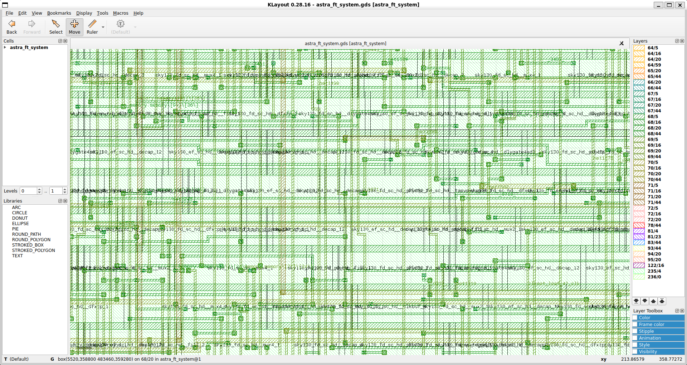
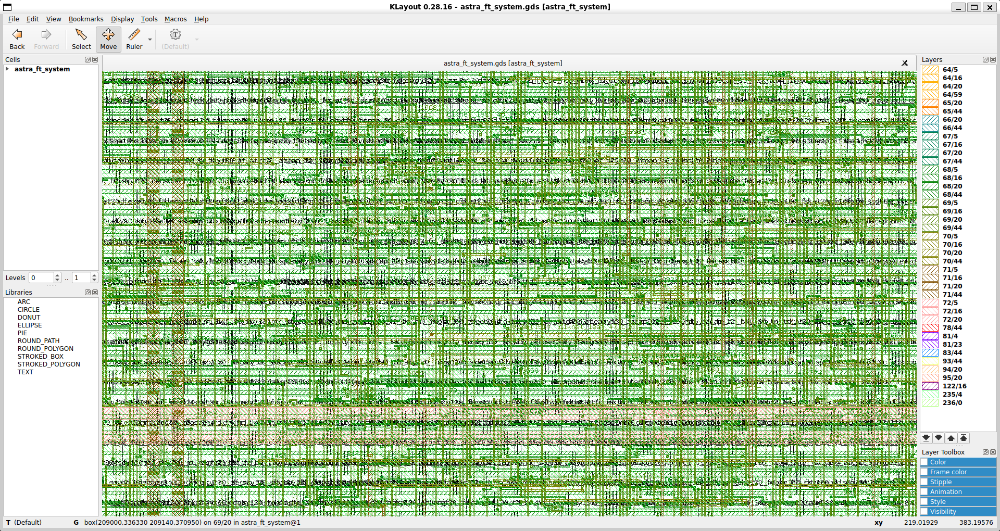

# ASTRA-FT
### Fault-Tolerant Digital System for Aerospace Applications

<p align="center">
  <strong>RTL Design · Fault Injection · ECC · FPGA Mapping · ASIC RTL-to-GDS</strong>
</p>

<p align="center">
  <a href="https://github.com/saiprabha-cy/ASTRA-FT">
    
  </a>
  
  
  
  
  
</p>

---

## 🚀 Project Overview

**ASTRA-FT** is an RTL-based fault-tolerant digital system exploring how hardware redundancy, error detection and correction, memory integrity, fault monitoring, and autonomous recovery can be combined into a resilient digital architecture inspired by aerospace computing requirements.

The design integrates **Triple Modular Redundancy (TMR)**, a majority voter, a **32-bit SECDED ECC** datapath, ECC-protected memory, a memory scrubber, watchdog-based recovery, and safe-mode logic. The system was verified through RTL simulation and fault-injection campaigns, then taken through generic synthesis, ECP5 FPGA architecture mapping experiments, and an open-source ASIC physical-design flow that generated GDS.

> **Project scope:** This is an engineering exploration and portfolio project—not a flight-qualified, radiation-qualified, fabricated, or hardware-validated aerospace computer.

## ✨ Key Features

| Capability | Implementation |
|---|---|
| Compute redundancy | Triple Modular Redundancy (3 replicas) |
| Fault masking | Majority voter |
| Fault awareness | Replica mismatch detection and fault identification |
| Data protection | 32-bit SECDED encoder/decoder |
| Storage integrity | ECC-protected 16-word memory |
| Error maintenance | ECC scrubber scans and repairs correctable faults |
| System supervision | Watchdog / recovery state machine |
| Escalation | Repeated failure → safe-mode transition |
| Verification | Unit, subsystem, integration, and fault-campaign testbenches |
| FPGA exploration | Yosys generic synthesis and ECP5 mapping/resource experiments |
| ASIC exploration | OpenLane RTL-to-GDS flow using SKY130 |

## 🧭 Contents

- [System Architecture](#-system-architecture)
- [Fault-Tolerance Strategy](#-fault-tolerance-strategy)
- [Verification and Fault Campaign](#-verification-and-fault-campaign)
- [Results Summary](#-results-summary)
- [FPGA Mapping and Experiments](#-fpga-mapping-and-experiments)
- [ASIC Physical Design](#-asic-physical-design)
- [Visual Results](#-visual-results)
- [Repository Structure](#-repository-structure)
- [Reproduce the Simulation](#-reproduce-the-simulation)
- [Tools and Technologies](#-tools-and-technologies)
- [Engineering Limitations](#-engineering-limitations)
- [Future Work](#-future-work)

---

## 🏗️ System Architecture



### Design blocks

<details>
<summary><strong>🧮 Triple Modular Redundancy (TMR)</strong></summary>

Three replica processing lanes execute the same operation. The majority voter selects the majority-agreed result, allowing the subsystem to tolerate a single divergent replica for the tested scenarios. Replica mismatch information is also used for fault detection and identification.

</details>

<details>
<summary><strong>🗳️ Majority Voter</strong></summary>

Combinational voting logic compares the three replica outputs and produces a voted output. The voter is tested independently and within the integrated TMR subsystem.

</details>

<details>
<summary><strong>🛡️ 32-bit SECDED ECC</strong></summary>

A 32-bit data word is encoded into a 39-bit codeword using single-error correction and double-error detection (SECDED). The decoder reports correction and uncorrectable-error status for tested error patterns.

</details>

<details>
<summary><strong>💾 ECC-Protected Memory</strong></summary>

The memory subsystem stores 32-bit payloads with ECC metadata. The configured memory depth is 16 words.

- Payload capacity: 16 × 32 = **512 data bits**
- Stored codeword width: **39 bits**
- Total stored codeword bits: 16 × 39 = **624 bits**
- ECC overhead relative to payload: **21.875%**

</details>

<details>
<summary><strong>🔄 ECC Scrubber</strong></summary>

The scrubber scans stored words, checks ECC status, repairs correctable single-bit errors, and records uncorrectable errors. The simulation validates correction and error-reporting behavior.

</details>

<details>
<summary><strong>⏱️ Watchdog, Recovery FSM and Safe Mode</strong></summary>

Heartbeat activity is monitored by a watchdog. Missing heartbeats trigger recovery behavior. Repeated failures escalate to a safe-mode state in the tested state-machine scenarios.

</details>

---

## 🧪 Verification and Fault Campaign

Verification was performed using SystemVerilog testbenches and simulation. The test plan includes block-level tests, subsystem tests, integration tests, and a fault campaign.

### Final integration regression

| Test | Result |
|---|---:|
| Startup state | PASS |
| Normal TMR arithmetic | PASS |
| Single replica fault tolerance and mismatch flag | PASS |
| Faulty lane identification | PASS |
| Voted result stored and retrieved through ECC memory | PASS |
| Single-bit ECC correction | PASS |
| Scrubber repairs correctable memory fault | PASS |
| Scrubbed location verified clean | PASS |
| Double-bit ECC error rejected | PASS |
| Scrubber reports uncorrectable word | PASS |
| Heartbeat activity prevents timeout | PASS |
| Heartbeat loss triggers recovery | PASS |
| Recovery/reset outputs agree | PASS |
| Heartbeat restoration returns watchdog to monitor | PASS |
| Repeated failures transition to safe mode | PASS |

**Final integration regression: 15/15 PASS · 0 FAIL**

### Fault campaign

The TMR fault campaign exercised multiple fault classes:

| Campaign | Cases | Purpose / observed outcome |
|---|---:|---|
| Exhaustive single-bit cases | 768 | Exercise single-bit fault behavior across the campaign's tested configurations |
| Randomized single-lane multi-bit cases | 200 | Explore multi-bit corruption within one replica |
| Double-lane fault cases | 100 | Demonstrate and record the tested two-lane fault behavior |
| Common-mode cases | 8 | Illustrate the limitation of redundancy against shared/common-mode faults |
| **Total** | **1,076** | **Campaign test cases** |

> Fault-injection outcomes are bounded by the testbench model and injected fault definitions. They do not establish radiation performance or real-device fault rates.

### Verification levels

- Unit tests: majority voter, SECDED encoder/decoder, watchdog FSM
- Subsystem/integration tests: TMR subsystem, ECC memory, scrubber
- Fault campaign: exhaustive and randomized injected fault scenarios
- Top-level regression: end-to-end behavior across TMR, memory, ECC, scrubber, watchdog, recovery, and safe mode

---

## 📊 Results Summary

### Functional verification

| Metric | Result |
|---|---:|
| Fault-campaign cases | **1,076** |
| Final integrated tests | **15 / 15 passed** |
| Integrated failures | **0** |
| SECDED test cases | **941 / 941 passed** |
| ECC-memory tests | **6 / 6 passed** |
| Scrubber tests | **6 / 6 passed** |
| Watchdog FSM tests | **8 / 8 passed** |
| Majority-voter tests | **10 / 10 passed** |
| TMR subsystem tests | **16 / 16 passed** |

### Generic synthesis

Yosys generic synthesis was performed on the individual blocks and the integrated design. These generic cell counts are **technology-independent synthesis statistics**; they are not FPGA LUT counts, ASIC area, or timing results.

| Block | Generic synthesized cells |
|---|---:|
| Replica core | 1,125 |
| TMR subsystem | 4,139 |
| ECC memory | 3,430 |
| ECC scrubber | 1,184 |
| Watchdog / recovery FSM | 514 |
| Integrated ASTRA-FT top | **9,299** |

### ECP5 architecture mapping

The integrated design was mapped for an ECP5 architecture using Yosys.

| Resource | Mapped count |
|---|---:|
| LUT4 | 2,340 |
| PFUMX | 759 |
| L6MUX21 | 391 |
| CCU2C | 166 |
| TRELLIS_FF | 224 |
| TRELLIS_DPR16X4 | 30 |
| Total mapped cells (reported) | 3,928 |

These are **synthesis/mapping results**, not a place-and-route result, bitstream, or physical FPGA demonstration.

---

## 🧩 FPGA Mapping and Experiments

Several mapping experiments were run to compare how selected resource classes and mapping options affect the resulting ECP5 resource report.

| Experiment | LUT4 | CCU2C | FF | Total mapped cells |
|---|---:|---:|---:|---:|
| Baseline | 2,340 | 166 | 224 | 3,928 |
| No CCU2 | 2,424 | 0 | 224 | 3,741 |
| No DFFE | 2,360 | 166 | 224 | 3,904 |
| No BRAM | 2,340 | 166 | 224 | 3,928 |
| No DSP | 2,105 | 166 | 224 | 3,382 |

### What the experiments suggest

- **No CCU2:** carry-chain resources disappear from the mapped report, while LUT usage increases. This is a mapping trade-off, not proof of a better implementation.
- **No DFFE:** the mapped resource distribution changes slightly.
- **No BRAM:** the result matches baseline; the small memory did not map to the ECP5 DP16KD block in this experiment. Distributed-memory primitives were present in the baseline mapping.
- **No DSP:** the mapped report shows fewer LUTs and cells, but the design is not DSP-heavy. This experiment should not be interpreted as a universal optimization win.

<details>
<summary><strong>📁 Mapping evidence files</strong></summary>

- `reports/fpga/astra_ft_ecp5.json`
- `reports/fpga/day10/baseline.json`
- `reports/fpga/day10/exp_nobram.json`
- `reports/fpga/day10/exp_noccu2.json`
- `reports/fpga/day10/exp_nodffe.json`
- `reports/fpga/day10/exp_nodsp.json`
- `reports/day10/ecp5_resource_comparison.csv`

</details>

---

## 🏭 ASIC Physical Design

ASTRA-FT was taken through an open-source RTL-to-GDS physical-design flow using **OpenLane**, **Yosys**, and **OpenROAD**, targeting the **SKY130** standard-cell environment.

### Flow stages explored

```mermaid
flowchart LR
    RTL[SystemVerilog RTL] --> LINT[Lint / Checks]
    LINT --> SYN[Synthesis]
    SYN --> FP[Floorplan]
    FP --> PDN[Power Distribution]
    PDN --> PL[Global / Detailed Placement]
    PL --> CTS[Clock-Tree Synthesis]
    CTS --> GR[Global Routing]
    GR --> DR[Detailed Routing]
    DR --> PV[Physical Verification]
    PV --> GDS[GDS Stream-Out]
```



### Physical-design status

| Check / deliverable | Status |
|---|---|
| OpenLane flow | Completed |
| Final GDS | Generated |
| Final DEF | Generated |
| Final physical netlist | Generated |
| Magic DRC | Pass reported |
| KLayout DRC | Pass reported |
| LVS | Pass reported |
| Setup violations | None reported by the run |
| Hold violations | None reported by the run |
| Antenna check | **Violations reported** |
| Maximum-slew check | **Warnings reported** |

**Important:** Antenna violations were reported (22 pin violations and 22 net violations in the reviewed run), and maximum-slew warnings remain. Therefore, this result is **not signoff-ready**. DRC/LVS pass results do not erase these other physical-design checks.

### Generated outputs

| Artifact | Output |
|---|---|
| GDS | `final/gds/astra_ft_system.gds` |
| KLayout-streamed GDS | `final/klayout_gds/astra_ft_system.klayout.gds` |
| Magic-streamed GDS | `final/mag_gds/astra_ft_system.magic.gds` |
| Final physical netlist | `final/pnl/astra_ft_system.pnl.v` |
| Final netlist view | `final/nl/astra_ft_system.nl.v` |
| DEF | `final/def/astra_ft_system.def` |
| Metrics | `final/metrics.json` and `final/metrics.csv` |

The final GDS from the reviewed run is approximately **20 MB**. The generated layout can be inspected using KLayout.

---

## 🖼️ Visual Results

### 1. Full ASIC Layout (`KLayout` — Zoom to Fit)


### 2. Zoomed Standard-Cell & Routing Detail (`KLayout`)


### 3. Zoomed Layer & Interconnect Geometry (`KLayout`)


## 📂 Repository Structure

```text
ASTRA-FT/
├── rtl/
│   ├── ecc/
│   │   ├── secded_encoder_32.sv
│   │   └── secded_decoder_32.sv
│   ├── memory/
│   │   └── ecc_memory_32.sv
│   ├── recovery/
│   │   └── watchdog_recovery_fsm.sv
│   ├── scrubber/
│   │   └── ecc_scrubber_32.sv
│   ├── tmr/
│   │   ├── majority_voter.sv
│   │   ├── replica_core.sv
│   │   └── astra_tmr_subsystem.sv
│   └── top/
│       └── astra_ft_system.sv
├── tb/
│   ├── unit/
│   ├── integration/
│   └── fault_campaign/
├── scripts/
│   ├── run_day3_campaign.sh
│   ├── run_day4_secded.sh
│   ├── run_day5_memory.sh
│   ├── run_day6_scrubber.sh
│   ├── run_day7_watchdog.sh
│   ├── run_day8_integration.sh
│   ├── run_day9_synthesis.sh
│   ├── day10/
│   └── day11/
├── reports/
│   ├── synthesis/
│   ├── fpga/
│   ├── day9_evidence/
│   ├── day10/
│   └── day11/
├── asic/
│   └── openlane/
├── sim/
│   ├── logs/
│   └── waveforms/
└── README.md
```

---

## ▶️ Reproduce the Simulation

### Prerequisites

The project uses open-source tools. Install/configure the tools required for the specific task you intend to run:

- Icarus Verilog (`iverilog`, `vvp`)
- GTKWave (waveform inspection)
- Verilator (lint/checking)
- Yosys (synthesis)
- OpenLane / OpenROAD (ASIC physical-design exploration)
- KLayout, Magic, Netgen (layout inspection and verification)
- Python 3 and Bash

### Run the final integration regression

From the repository root:

```bash
./scripts/run_day8_integration.sh
```

The integration testbench exercises the top-level system's normal operation, replica fault behavior, ECC memory correction, scrubber behavior, watchdog recovery, and safe-mode escalation.

### Run the fault campaign

```bash
./scripts/run_day3_campaign.sh
```

### Run the SECDED tests

```bash
./scripts/run_day4_secded.sh
```

### Run synthesis

```bash
./scripts/run_day9_synthesis.sh
```

> Other test scripts are available under `scripts/`. Run them from the repository root and check the script output for its pass/fail summary.

---

## 🧰 Tools and Technologies

| Category | Tools |
|---|---|
| RTL | SystemVerilog |
| Simulation | Icarus Verilog, VVP |
| Waveform analysis | GTKWave |
| Lint / checks | Verilator |
| Generic synthesis | Yosys |
| FPGA mapping | Yosys ECP5 architecture mapping |
| ASIC flow | OpenLane, OpenROAD |
| Layout viewing | KLayout |
| DRC / extraction | Magic |
| LVS | Netgen |
| Automation | Bash, Python |
| Version control | Git, GitHub |

---

## ⚠️ Engineering Limitations

ASTRA-FT is an educational and portfolio engineering project. The results should be interpreted within the scope of the simulation and open-source tool flow.

- No FPGA-board implementation or physical hardware test has been performed.
- No ASIC has been fabricated.
- No radiation testing, SEU testing, or radiation qualification has been performed.
- Fault-injection results depend on the fault models and testbench coverage.
- TMR does not inherently protect against common-mode faults, voter faults, shared logic faults, or every multi-lane failure.
- FPGA results are synthesis/mapping reports; no FPGA place-and-route, bitstream, or board validation is claimed.
- ASIC DRC and LVS results are reported alongside unresolved antenna violations and maximum-slew warnings.
- The physical-design flow is an open-source educational exploration—not foundry signoff or flight certification.
- The architecture is not a flight computer and is not intended for deployment in a spacecraft.

---

## 🔭 Future Work

Potential advanced extensions, prioritized for engineering value:

- [ ] Formal verification of majority-voter, ECC, watchdog, and safe-mode properties
- [ ] Expanded fault models: transient, stuck-at, burst, correlated, and common-mode faults
- [ ] Fault injection into the voter, ECC logic, scrubber, control FSM, and memory-control paths
- [ ] Fault-coverage analysis with clearly defined denominators and fault classes
- [ ] Timing constraints and timing analysis with documented assumptions
- [ ] Antenna-violation investigation and mitigation
- [ ] Maximum-slew violation investigation and mitigation
- [ ] Physical-design iteration and improved reports
- [ ] FPGA place-and-route and board validation when suitable hardware is available
- [ ] Radiation-effects literature review and a radiation-aware design study
- [ ] Architectural comparison: TMR vs. selective redundancy vs. recovery-based approaches

---

## 📌 Project Status

**Core RTL, simulation verification, fault-campaign testing, generic synthesis, ECP5 mapping experiments, and an educational ASIC RTL-to-GDS flow have been completed.**

The project currently demonstrates a simulation-verified fault-tolerant architecture and generated physical-design artifacts. Hardware validation, formal verification, radiation qualification, and physical-design cleanup remain future work.

---

## 📜 License

